# Практическое задание 9. Git

## Настройка

Указал имя, почту, редактор nvim и ветку main по умолчанию. Ещё добавил алиас `lol` для `git log --oneline --graph --all`.

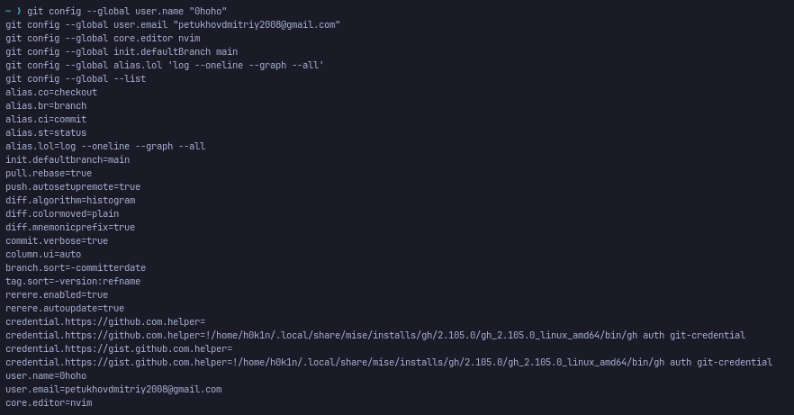

Создал репозиторий c-labs на GitHub и склонировал его. В нём сделал папку lab9_git и README.md, закоммитил и запушил.

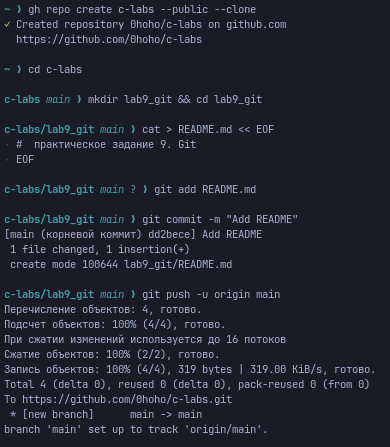

## Оценка 3

### sort.c

Посмотрел, на какой я ветке, и сделал `git log`. Пока там один коммит.

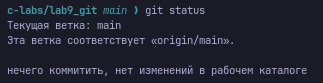

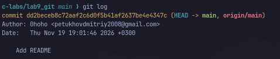

Создал sort.c с функцией сортировки пузырьком. Git его пока не видит: файл untracked.

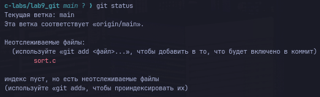

Добавил файл в индекс командой `git add`, теперь он в списке на коммит.

Сделал коммит. Изменений нет, но ветка опережает origin/main на 1 коммит, потому что я ещё не сделал push.

Дописал в sort.c комментарий. Файл modified, но в индексе его нет. После `git add` он попал в индекс.

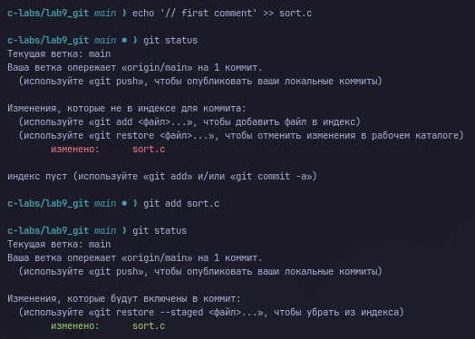

Дописал второй комментарий и сделал коммит без `git add`. В коммит попал только первый комментарий, потому что коммит берёт то, что лежит в индексе. Второй остался в файле как несохранённое изменение, поэтому в status файл снова modified. Потом добавил его, закоммитил и сделал push.

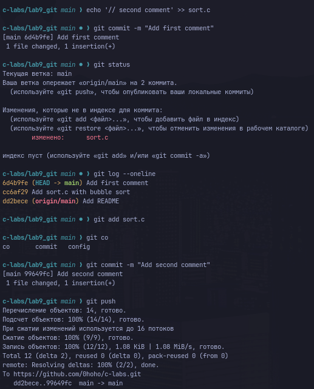

### Ветки

Создал ветку mybranch, посмотрел список веток, перешёл на неё и обратно на main. `git status` пишет, на какой я ветке. В mybranch нет строки про origin, потому что на GitHub её ещё нет.

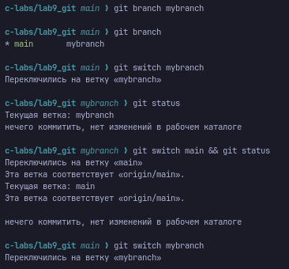

В mybranch создал file1.txt со своим именем и закоммитил. В `git log --oneline --graph` mybranch стоит на новом коммите.

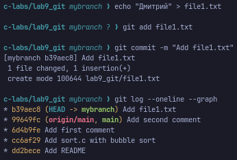

Перешёл на main. Коммита с file1.txt тут нет. Создал file2.txt и закоммитил. По `git lol` видно, что ветки разошлись: у каждой свои коммиты.

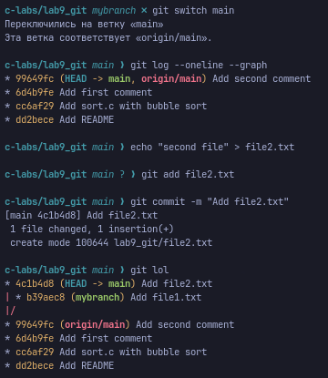

В mybranch нет file2.txt, он остался в main. `git diff mybranch main` показывает, что file1.txt в main нет, а file2.txt есть.

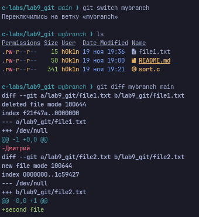

Закоммитил отчёт в mybranch и запушил ветку (`git push -u origin mybranch`). Потом запушил main.

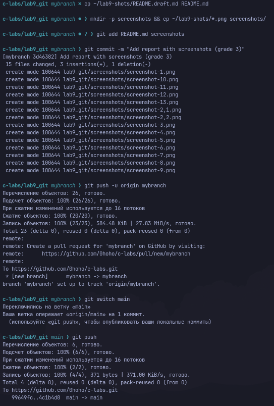

На GitHub появились обе ветки.

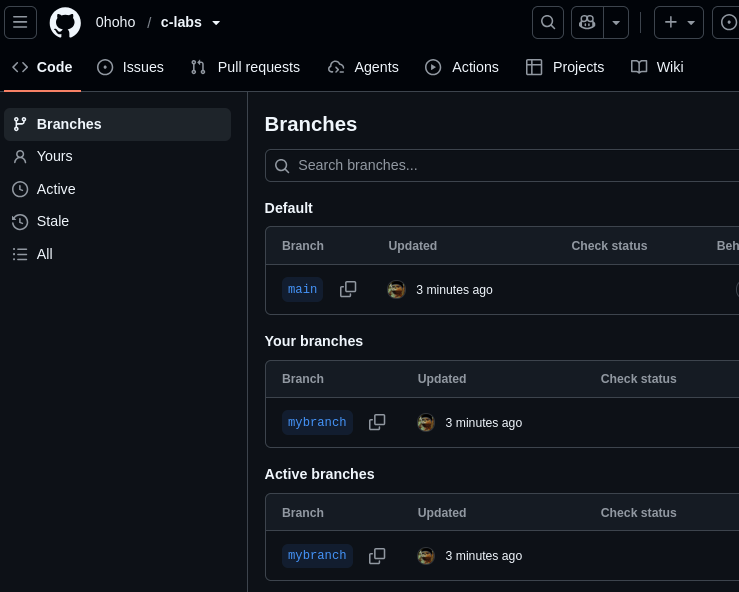

## Оценка 4

### sort.c: diff и restore

Переключился на mybranch и переписал sort.c: добавил main() с массивом {4, 2, 0} и вызовом сортировки. Программа выводит 0 2 4.

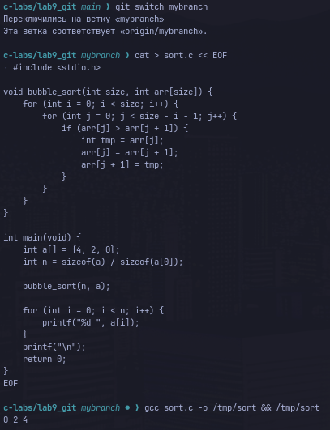

`git diff` показывает все изменения, а `git diff --staged` пустой: в индексе пока ничего нет. После `git add sort.c` наоборот: `git diff` пустой, а `git diff --staged` показывает изменения.

Убрал из массива 0. Теперь `git diff` показывает только это удаление, а `git diff --staged` показывает версию из индекса (с нулём). Дело в том, что `git diff` сравнивает рабочую папку с индексом, а `git diff --staged` индекс с последним коммитом, поэтому они показывают разное. В `git status` sort.c теперь два раза: в «Changes to be committed» и в «Changes not staged for commit».

`git restore --staged sort.c` убрал файл из индекса, сам файл не изменился. В status он теперь только в «not staged». Потом добавил и закоммитил, в `git lol` виден новый коммит в mybranch.

Добавил в main() строку `printf("hello git\n");`. В sort.c она появилась, status показывает modified. `git restore sort.c` отменил это изменение.

После restore строки printf в файле нет, в status нечего коммитить.

Запушил mybranch с обновлённым отчётом.

### Ветки и fast-forward merge (ветка main)

На `main` создал пустой `greeting.txt` и закоммитил (`Add file greeting.txt`), затем записал в него `hello` и закоммитил (`Add content to greeting.txt`). Создал ветку `feature/uppercase` и переключился на неё. `git status` показывает ветку `feature/uppercase` и отсутствие изменений.

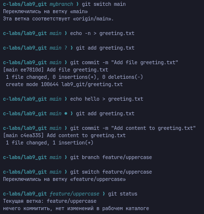

В `feature/uppercase` заменил содержимое на `HELLO` и закоммитил. `git branch` показывает три ветки, а `git lol`: `feature/uppercase` на один коммит впереди `main`.

Вернулся на `main`: в `greeting.txt` всё ещё `hello`. `git diff main feature/uppercase` показывает замену `hello` на `HELLO`. `git merge feature/uppercase` прошёл как fast-forward: у `main` не появилось новых коммитов, поэтому Git просто сдвинул указатель ветки вперёд и не создал нового коммита. Теперь в файле `HELLO`. Ветку `feature/uppercase` удалил (`git branch -d`).

Смержил `mybranch` в `main` (`git merge mybranch`). Это не fast-forward: ветки разошлись, поэтому Git создал коммит слияния `Merge branch 'mybranch'` с двумя родителями. Конфликтов нет, потому что в ветках менялись разные файлы.

`git lol` показывает слияние (ромб из двух линий), затем отправил `main` на GitHub (`git push`).

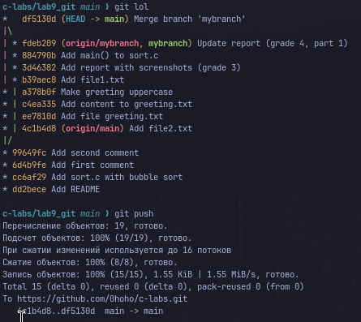

### Ветки и fast-forward

Перешёл на main, создал пустой greeting.txt и закоммитил. Потом записал в него hello и тоже закоммитил. Создал ветку feature/uppercase и перешёл в неё.

В feature/uppercase заменил текст на HELLO и закоммитил. В `git lol` ветка feature/uppercase на один коммит впереди main.

Вернулся на main, там по-прежнему hello. `git diff main feature/uppercase` показывает замену hello на HELLO. Слил ветку, получился fast-forward: пока я работал в feature/uppercase, в main новых коммитов не было, поэтому Git просто сдвинул main вперёд без нового коммита. В файле теперь HELLO. Ветку feature/uppercase удалил.

Слил mybranch в main. Тут fast-forward не получился, потому что ветки разошлись, и Git сделал коммит слияния. Конфликтов нет: в ветках менялись разные файлы.

В `git lol` виден коммит слияния. После этого запушил main.

