# Практическое задание 9. Git

Все действия выполнены в папке `lab9_git` репозитория `c-labs`. Основная ветка называется `main` (в тексте задания она `master`).

## Начальная настройка

Задал имя и почту, редактор `nvim`, основную ветку `main` и алиас `lol` (сокращение для `git log --oneline --graph --all`).

Создал репозиторий `c-labs` на GitHub, склонировал его, создал папку `lab9_git` с `README.md`, закоммитил и отправил на GitHub (`git push -u origin main`).

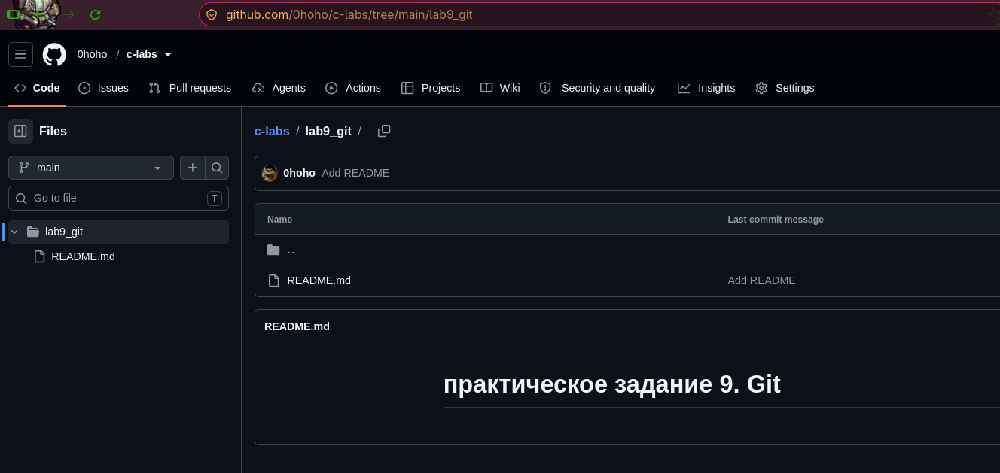

## Оценка 3

### Файл sort.c

`git status` показывает, что я на ветке `main` и изменений нет. В `git log` один коммит `Add README`.

Создал `sort.c` с функцией сортировки пузырьком. Новый файл Git пока не отслеживает (untracked), в индексе ничего нет.

После `git add sort.c` файл попал в индекс: секция «Changes to be committed», новый файл.

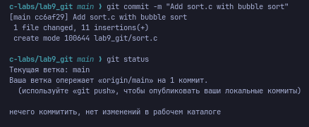

После `git commit` рабочий каталог чистый, но ветка опережает `origin/main` на 1 коммит: коммит есть только локально.

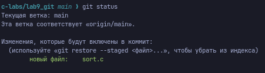

Дописал комментарий: файл `modified`, но не в индексе. После `git add` он попал в индекс.

Дописал второй комментарий и сделал коммит без `git add`. В коммит вошёл только первый комментарий (он лежал в индексе), а второй остался изменением в рабочем каталоге, поэтому `git status` снова показывает `modified`. Коммит берёт содержимое индекса, а не рабочего каталога. Затем `git add`, `git commit` и `git push`.

### Ветки

Создал ветку `mybranch`, `git branch` показывает обе ветки (текущая отмечена `*`). Переключался между ветками: `git status` в первой строке показывает текущую ветку. У `mybranch` нет строки про `origin`, потому что на GitHub этой ветки ещё нет.

В `mybranch` создал `file1.txt` со своим именем и закоммитил. `git log --oneline --graph` показывает, что `mybranch` указывает на новый коммит `Add file1.txt`.

Вернулся на `main`: коммита с `file1.txt` здесь нет. Создал `file2.txt` и закоммитил. `git lol` показывает развилку: у `main` и `mybranch` теперь разные коммиты.

В `mybranch` файла `file2.txt` нет, потому что он есть только в истории `main`. `git diff mybranch main` показывает: `file1.txt` в `main` отсутствует, `file2.txt` добавлен.

Добавил отчёт в `mybranch`, закоммитил и отправил ветку (`git push -u origin mybranch`), затем отправил изменения `main`.

На GitHub две ветки: `main` и `mybranch`.

## Оценка 4

### sort.c: diff и restore (ветка mybranch)

В `mybranch` переписал `sort.c`: добавил `main()` с массивом `{4, 2, 0}` и вызовом сортировки. Программа печатает `0 2 4`.

`git diff` показывает все изменения (рабочий каталог против индекса), а `git diff --staged` пуст: в индексе ничего нет. После `git add sort.c` наоборот: `git diff` пуст, а `git diff --staged` показывает все изменения (индекс против последнего коммита).

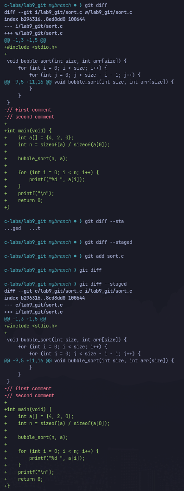

Убрал число `0` из массива (`{4, 2}`). Теперь `git diff` показывает только это удаление, а `git diff --staged` показывает прежнюю версию с `{4, 2, 0}`. Происходит следующее: у файла одновременно три версии (в последнем коммите, в индексе и в рабочем каталоге), и `diff` сравнивает разные пары. Поэтому `sort.c` в `git status` присутствует дважды: как «Changes to be committed» и как «Changes not staged for commit».

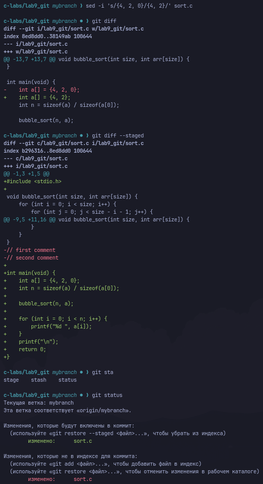

`git restore --staged sort.c` убрал файл из индекса (содержимое файла не изменилось), поэтому в `git status` он остался только в «not staged». Затем `git add` и `git commit`, `git lol` показывает новый коммит в `mybranch`.

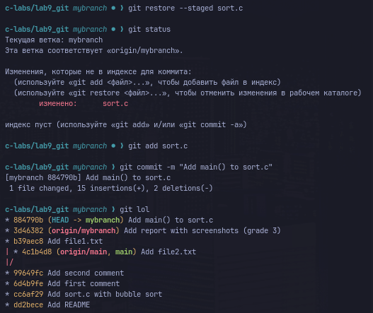

Добавил в `main()` строку `printf("hello git\n");`: `cat sort.c` её показывает, `git status` — `modified`. `git restore sort.c` отбросил это изменение безвозвратно.

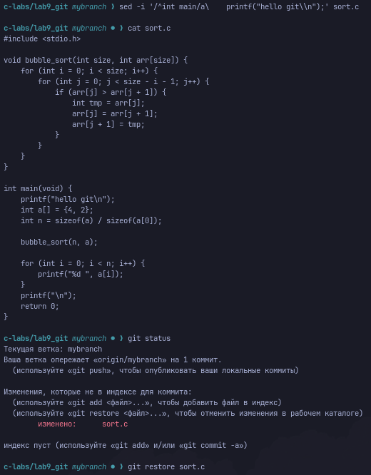

После `restore` строки с `printf` в `sort.c` нет, `git status`: нечего коммитить.

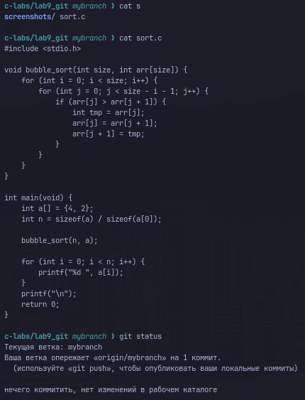

Отправил ветку `mybranch` на GitHub с обновлённым отчётом.

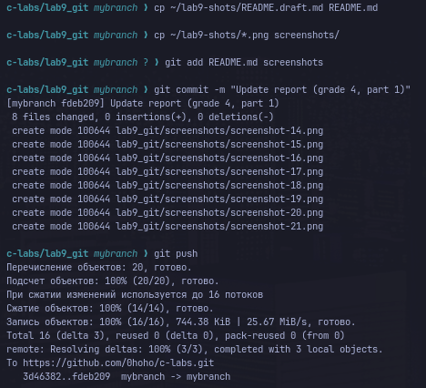

### Ветки и fast-forward merge (ветка main)

На `main` создал пустой `greeting.txt` и закоммитил (`Add file greeting.txt`), затем записал в него `hello` и закоммитил (`Add content to greeting.txt`). Создал ветку `feature/uppercase` и переключился на неё. `git status` показывает ветку `feature/uppercase` и отсутствие изменений.

В `feature/uppercase` заменил содержимое на `HELLO` и закоммитил. `git branch` показывает три ветки, а `git lol`: `feature/uppercase` на один коммит впереди `main`.

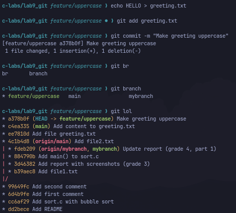

Вернулся на `main`: в `greeting.txt` всё ещё `hello`. `git diff main feature/uppercase` показывает замену `hello` на `HELLO`. `git merge feature/uppercase` прошёл как fast-forward: у `main` не появилось новых коммитов, поэтому Git просто сдвинул указатель ветки вперёд и не создал нового коммита. Теперь в файле `HELLO`. Ветку `feature/uppercase` удалил (`git branch -d`).

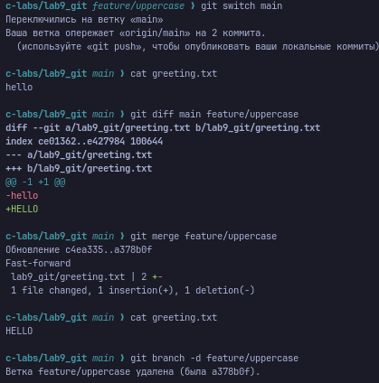

Смержил `mybranch` в `main` (`git merge mybranch`). Это не fast-forward: ветки разошлись, поэтому Git создал коммит слияния `Merge branch 'mybranch'` с двумя родителями. Конфликтов нет, потому что в ветках менялись разные файлы.

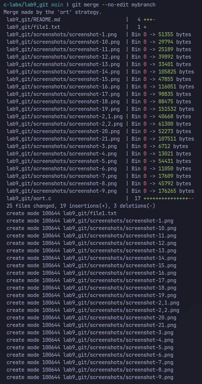

`git lol` показывает слияние (ромб из двух линий), затем отправил `main` на GitHub (`git push`).

